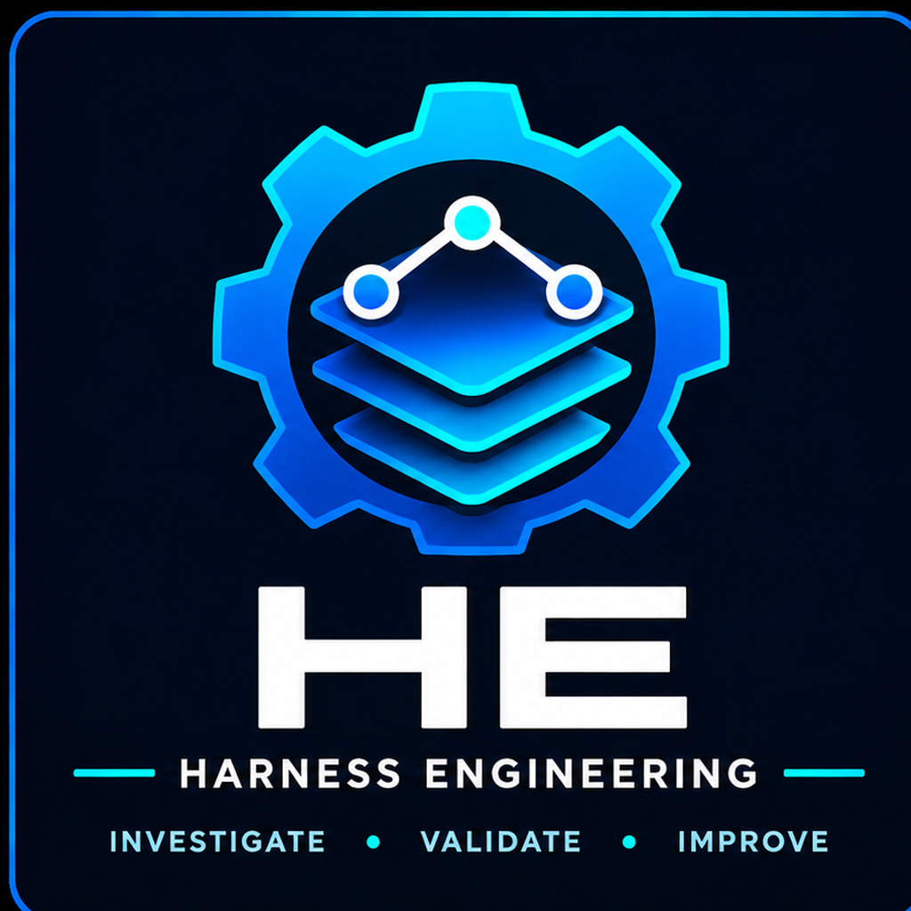

# Harness Engineering

  

Engineering principles, patterns, and reference implementations for designing, auditing, and optimizing AI harnesses.

## License

This repository is **not currently released under an open-content or open-source license**.

Unless a file explicitly states otherwise, the research, writing, diagrams, assessments, decisions, and other original material in this repository are © 2026 Eric Nolan. All rights reserved.

Public visibility allows the work to be read and referenced; it does not grant blanket permission to copy, redistribute, modify, or republish the repository's contents. Licensing may be revisited later if a clear reuse goal justifies it.
